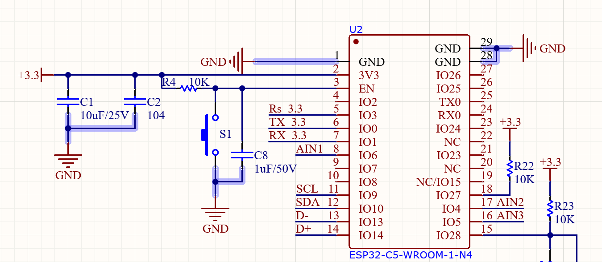

# Sơ đồ kết nối do người dùng cung cấp · 2026-10-10

Ảnh chỉ thể hiện phía module C5; chưa có phần mạch Nuvoton hay chuyển mức.

| Chân C5 | Nhãn trên ảnh | Cách nối Nuvoton do người dùng xác nhận |
|---|---|---|
| IO0 | TX 3.3 | CLK |
| IO1 | RX 3.3 | DAT |
| IO3 | Rs 3.3 | RESET |
| IO6 | AIN1 | Không dùng cho ICP |
| IO4 | AIN2 | Không dùng cho ICP |
| IO5 | AIN3 | Không dùng cho ICP |

Ngày 2026-10-10, thử hai xung riêng trên GPIO3 qua USB JTAG của C5, mỗi xung yêu cầu kéo thấp 100 ms bằng open-drain rồi thả. Đọc đầu vào C5 xác nhận 1 → 0 → 1 và khôi phục mux/matrix/output như trước thử. Người dùng xác nhận Nuvoton đã reset sau lần thứ hai. Không xóa hay nạp flash Nuvoton; chưa kiểm tra nhận dạng hoặc truyền dữ liệu ICP qua CLK/DAT.

Ảnh ghi ESP32-C5-WROOM-1-N4. Bo USB thử nghiệm trước đó được nhận dạng có flash 16 MiB; đây là khác biệt giữa nhãn sơ đồ và bo đã kiểm tra, không tự đổi cấu hình flash từ ảnh. Xác nhận đúng module/dung lượng trước khi nạp sang bo khác.

Firmware đang chạy khi thử là simulator 3.0; xung được tạo trực tiếp qua USB để kiểm tra dây. Thay đổi mặc định chân ICP trong mã nguồn không tự chuyển firmware đang chạy thành bản dùng target thật.

## Kiểm thử firmware thật ngày 2026-10-10

Đã nạp bản ICP thật lên C5 qua USB JTAG, chỉ ghi phân vùng ứng dụng và xác minh thành công. NVS giữ nguyên từng byte so với bản sao lưu; Wi-Fi và MQTT đã kết nối lại với tài khoản đã ghép. Tự nạp Nuvoton khi khởi động được tắt.

Phát hiện và sửa tình trạng lệnh ICP bị chờ UART vô hạn: ở tick 100 Hz, khoảng nghỉ 5 ms bị làm tròn thành 0 tick. Vòng nhận UART nay nghỉ ít nhất một tick sau mỗi lượt đọc để tác vụ ICP có thể lấy mutex, kể cả khi UART nhận dữ liệu liên tục.

Ba yêu cầu `/api/info` liên tiếp trả HTTP 200, nhận PDID `0x0B005332`, CID `0xDA`, APROM 32768 byte, LDROM 0 byte, CONFIG `FF FF FF FF 0F`, trạng thái không khóa. Đây là kết quả đọc từ MS51 thật qua GPIO0/1/3; chưa ghi hoặc xóa flash Nuvoton.

## Khởi động bằng nguồn ngoài, không có USB

Người dùng xác nhận dây USB chỉ nối D+, D− và GND, không nối 5 V. Bản trước có hiện tượng không lên mạng khi bật nguồn riêng; RESET/EN không khắc phục. Khi cắm USB mà không reset, log khởi tạo Wi-Fi tiếp tục ở khoảng 40978 ms. Điều này cho thấy ứng dụng bị chậm/kẹt trong quá trình khởi động trước khi có USB; chưa xác định chính xác dòng bên trong SDK gây chặn.

Bản sửa khởi tạo UART của MS51 trước mạng, bỏ qua log USB khi không có host, và chỉ tạo console USB trong tác vụ riêng sau khi dịch vụ mạng đã khởi tạo và host hiện diện. Console không còn là bước bắt buộc trước UART/Wi-Fi. Đã build, nạp riêng phân vùng ứng dụng và xác minh flash; NVS trước/sau nạp giống từng byte. Console `help` vẫn hoạt động khi có USB.

Kiểm thử trực tiếp: rút USB, tắt/bật nguồn riêng; máy tính xác nhận không có COM49. HTTP mất kết nối trong lúc tắt nguồn rồi hoạt động lại; bộ đếm UART giảm từ 8064 trước tắt nguồn xuống 3060 sau khởi động và tiếp tục tăng. Hai lần đọc sau đó ghi nhận MQTT online, dữ liệu UART mới trong vòng 272 ms và bộ đếm tăng 7833 → 8217. File MS51 đã tải lên vẫn là `ms51_runtime_uart.hex`, generation 12. Không ghi/xóa flash Nuvoton trong lần sửa này.
