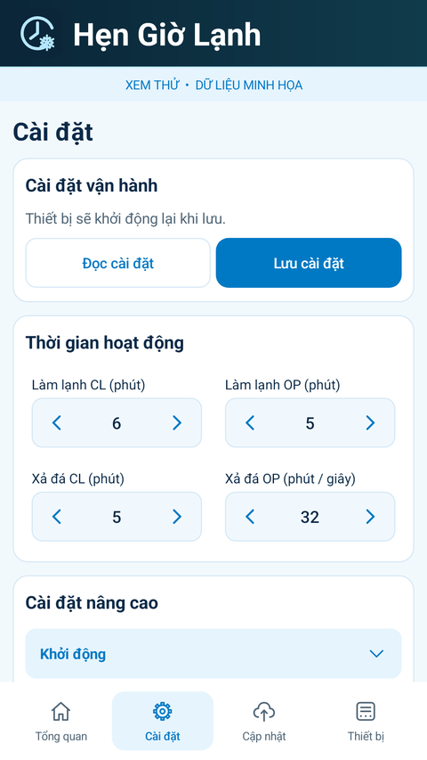
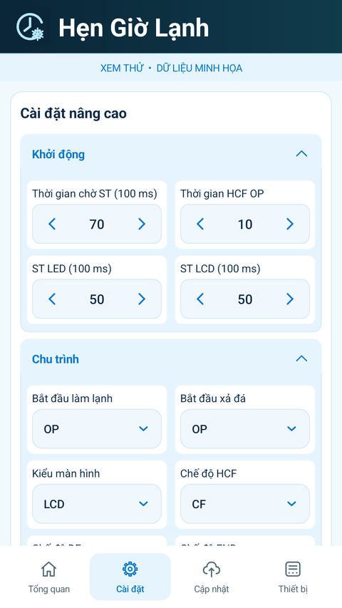
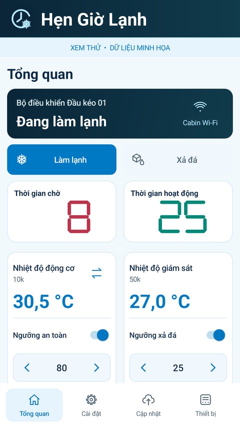

# Hẹn Giờ Lạnh 3.6.2

[Tải APK](https://103-9-78-139.sslip.io/downloads/Hen-Gio-Lanh-3.6.2.apk) · [GitHub Release](https://github.com/dangdangduong2k2/esp32c5-ms51-icp/releases/tag/v3.6.2)

Bản 3.6.0/3.6.1 mới đổi theme/logo và một phần bố cục nên chưa bám đầy đủ bản concept. 3.6.2 cập nhật thành phần Android thật: thẻ gọn hơn, viền xanh nhạt, chữ navy, tiêu đề không có icon thừa, ô chọn/ô số đồng bộ, nhóm mở rộng có nền liền mạch. Wi-Fi nằm bên phải trạng thái ở cỡ chữ thường; chuyển xuống dưới khi màn hình hẹp hoặc chữ lớn. Các vùng bấm tăng/giảm vẫn tối thiểu 48dp.

## Bố trí theo video mới

- **Khởi động**, bên trong **Cài đặt nâng cao**: hàng 1 Thời gian chờ ST + Thời gian HCF OP; hàng 2 ST LED + ST LCD.
- **Chu trình**: Bắt đầu làm lạnh + Bắt đầu xả đá; tiếp theo Kiểu màn hình + Chế độ HCF; tiếp theo DF + END, HDF + Trễ bật xả đá và Số lần bật nguồn/khởi động.
- Bỏ nhóm HCF riêng. Kiểu màn hình chuyển khỏi Hiển thị và thao tác.
- Giới hạn thời gian hiển thị bảng Tham số / Min / Max khi rộng từ 400dp, chữ dưới 115%. Màn hình nhỏ dùng từng cặp Min/Max; chữ lớn chuyển một cột.
- Các giá trị, giới hạn, quyền hiển thị, nút Lưu và hành vi điều khiển được giữ nguyên. Hiện ST LED và OP tính giây vẫn chỉ do admin quản lý.

Bản concept là hình tham chiếu; APK dùng thành phần Android thật, có thêm trạng thái tải/lỗi/không có quyền và thích ứng cỡ chữ. Không sao chép dữ liệu minh họa của concept làm cài đặt thật.

## Cài đặt và kiểm tra

Cài đè APK 3.6.2 (versionCode 53), cùng application ID/chữ ký với 3.6.1. Tiếp tục dùng VPS VinaHost hiện tại; không cần nạp C5/MS51 cho thay đổi giao diện này.

Build/lint và kiểm tra offline đã qua: tăng giảm có gia tốc, giới hạn số, nhập tay, lựa chọn menu, đóng/mở nhóm giữ giá trị chưa lưu, quyền admin, giữ vị trí cuộn, nguồn cảm biến/hai ngưỡng, trạng thái chế độ/đếm giờ và vẽ thẻ trạng thái. Xem [kết quả](test-results.json).

Ảnh dưới được chụp từ giao diện Android với dữ liệu minh họa, không gửi lệnh tới bo. Đã kiểm tra 360dp, 411dp, chữ 140% và chiều ngang. Chưa kiểm tra bản này trên điện thoại vật lý.

