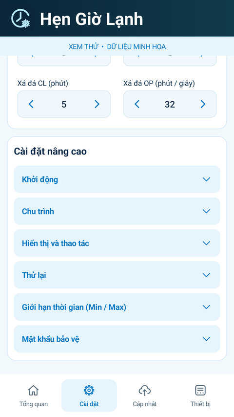

# Hẹn Giờ Lạnh 3.6.3

[Tải APK](https://103-9-78-139.sslip.io/downloads/Hen-Gio-Lanh-3.6.3.apk) · [GitHub Release](https://github.com/dangdangduong2k2/esp32c5-ms51-icp/releases/tag/v3.6.3)

Giới hạn thời gian (Min / Max) và Mật khẩu bảo vệ nay nằm trong Cài đặt nâng cao. Mỗi nhóm mặc định thu gọn, nhấn tiêu đề để mở/đóng. Đóng nhóm giữ giá trị chưa lưu và dừng thao tác giữ tăng/giảm; quyền hiện/ẩn vẫn áp dụng như trước.

Cài đè lên 3.6.2, không cần nạp C5/MS51. Build/lint và kiểm tra offline Android đã qua; xem [kết quả](test-results.json). Ảnh từ app thật với dữ liệu minh họa.

