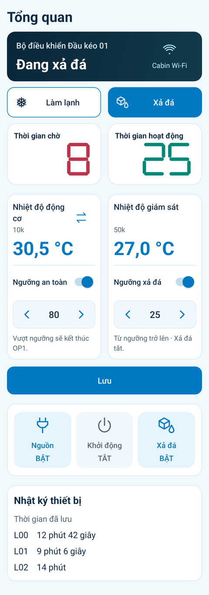

# Hẹn Giờ Lạnh 3.6.4

[Tải APK](https://103-9-78-139.sslip.io/downloads/Hen-Gio-Lanh-3.6.4.apk) · [GitHub Release](https://github.com/dangdangduong2k2/esp32c5-ms51-icp/releases/tag/v3.6.4)

Tên Nhiệt độ động cơ bị xuống hai dòng cạnh nút đổi cảm biến, khiến số nhiệt độ và đường phân chia thấp hơn thẻ giám sát. Hai thẻ nay dành cùng khoảng trống hai dòng cho tiêu đề để căn số, nhãn cảm biến và đường phân chia thẳng hàng.

Nút chế độ chưa chọn dùng nền trắng và viền xanh rõ, tách khỏi nền trang. Nút đang chọn vẫn nền xanh, chữ trắng; trạng thái đang gửi/xác nhận và lỗi vẫn giữ như trước.

Cài đè APK 3.6.4; không cần nạp C5/MS51. Build/lint và kiểm thử offline đã qua. Đã xem ảnh ở 360dp với chữ thường/115%, cả Làm lạnh và Xả đá đang chọn. Chưa thử trên điện thoại vật lý. [Kết quả](test-results.json).

Ảnh từ giao diện Android thật, dữ liệu minh họa:

