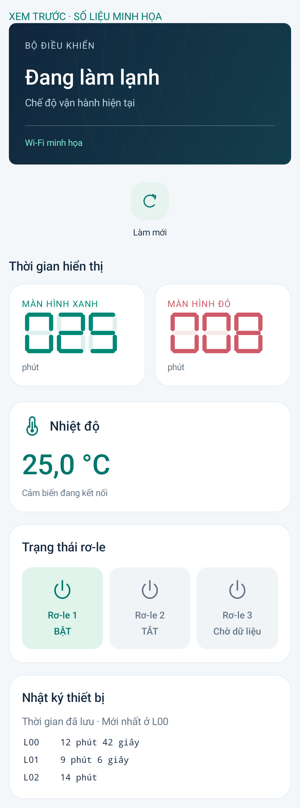

# MS51 Connect 3.1.3 — Nhiệt độ NTC ở IO1

Dành cho ESP32-C5 DAT2 / CLK3 / RS4; cần cài APK 3.1.3 và nạp bộ ba file C5 mới. Không cần cập nhật VPS hoặc nạp lại MS51.

## Đấu dây

```text
3,3 V ── điện trở 10 kΩ ──┬── IO1 (ESP32-C5)
                          │
                    NTC 10 kΩ B3950
                          │
                         GND
```

Dùng chung GND, nguồn bộ chia 3,3 V. Không nối cảm biến vào IO1 trên bản DAT1/CLK0/RS3 vì chân này đang dùng để liên lạc MS51. Tùy chọn đọc IO1 mặc định tắt và bị khóa khi trùng chân; script build DAT2/CLK3/RS4 bật tùy chọn này.

## Dữ liệu

ADC1 channel 0, 12 bit, attenuation 12 dB, hiệu chuẩn curve fitting của ESP-IDF. Lấy trung bình 16 mẫu mỗi 250 ms; lỗi đọc/hiệu chuẩn không trả nhiệt độ giả. Công thức điện trở: Rntc = 10000 × Vio1 / (3300 − Vio1), V tính bằng mV. Sau đó dùng mô hình Beta với R25 = 10000 Ω, T25 = 298,15 K và B = 3950 K. Nhiệt độ phụ thuộc sai số nguồn 3,3 V thực tế, điện trở, NTC và ADC; chưa hiệu chỉnh thực nghiệm.

`/api/status.analog` gồm `enabled`, `gpio`, `valid`, `raw`, `millivolts`, `age_ms`, `sensor`, `temperature_centi`. Khi cảm biến hợp lệ, `temperature_centi` là số nguyên 1/100 °C; app hiển thị một chữ số thập phân. 1650 mV tương ứng 25 °C. Đường chuyển tiếp MQTT hiện có giữ đối tượng này, không cần API/máy chủ mới.

Các giá trị <= 10 mV được phân loại `short`; >= 3290 mV hoặc ADC raw >= 4090 được phân loại `open`. Mô hình chỉ trả giá trị trong -55..125 °C. Ngoài khoảng, dây hở/chập hoặc mẫu cũ hơn 2 giây trả null/không có số đo. App hiển thị “Kiểm tra dây cảm biến”, “Nhiệt độ ngoài khoảng đo” hoặc “Đang chờ dữ liệu”; bản C5 chưa hỗ trợ báo rõ trên thẻ. Các ngưỡng hở/chập cần xác nhận trên mạch thực tế.

## Kiểm thử và xem trước

Đã build C5, kiểm tra chip/ảnh flash/phân vùng, build APK và lint không lỗi. Kiểm thử Android API 35 bao gồm số âm/0/25/125 °C, lỗi cảm biến, dữ liệu cũ/null, bản C5 cũ và hồi quy phân quyền/cập nhật/nhật ký. Chưa nạp hoặc đo cảm biến thật trong lần này. [Báo cáo](test-results.json).

Ảnh chụp view thật của app trên emulator; 25 °C và các số khác là **dữ liệu minh họa**.


