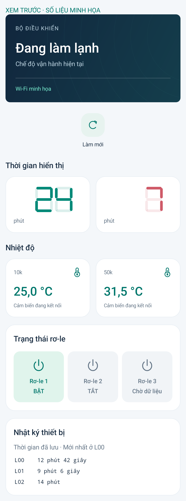

# MS51 Connect 3.1.5 — Hai ô nhiệt độ và nhấp nháy ô đếm

Bỏ nhãn MÀN HÌNH XANH/ĐỎ. Số không thêm 0 phía trước: 007 → 7, 025 → 25, 000 → 0; vị trí trống không vẽ segment. Ô số giảm được nhấp nháy nhẹ (600 ms sáng dần, 600 ms mờ dần). Nhiệt độ chia hai cột, nhãn nhỏ 10k bên trái và 50k bên phải.

## Đấu dây

Giữ DAT = IO1, CLK = IO0, RS = IO3.

- 3,3 V → trở **10 kΩ** → **IO6** → NTC **10 kΩ B3950** → GND.
- 3,3 V → trở **10 kΩ** → **IO4** → NTC **50 kΩ B3950** → GND.

Hai bộ chia riêng, chung GND. ADC1 channel 5 và 3 có hiệu chuẩn và mẫu riêng. Mô hình Beta dùng R25 tương ứng 10k hoặc 50k; cả hai pullup là 10k. Tại 25 °C, điện áp lý thuyết lần lượt 1650 và 2750 mV. Nguồn, sai số linh kiện và ADC ảnh hưởng độ chính xác; chưa đo thực tế. Dữ liệu `analog` giữ tương thích 10k, `analog50k` bổ sung 50k. Hở/chập, ngoài khoảng hoặc mẫu cũ xử lý riêng từng ô; không sao chép số đo giữa hai cảm biến.

## Nhấp nháy

MS51 hiện chỉ gửi số hiển thị, chưa có cờ đang đếm/tạm dừng. App so sánh mẫu mới trong COOL/ICE_FLUSH: một ô giảm và ô kia giữ nguyên thì đánh dấu ô giảm. Khi mới mở app phải đợi lần số giảm, có thể khoảng một phút với màn hình phút. Đây là nhận biết từ chuyển động, không phải tín hiệu tức thời từ MS51.

Nhịp được giữ tối đa 70 giây sau lần giảm khi vẫn nhận dữ liệu mới; tăng/reset/đổi chế độ, dữ liệu không hợp lệ hoặc quá cũ sẽ hủy. Khi không nhận phản hồi trong 5 giây, hoặc rời màn hình, hiệu ứng dừng và phục hồi độ sáng. Trường hợp MS51 tạm dừng nhưng vẫn gửi số không đổi chưa thể phát hiện ngay; muốn biết chính xác tức thời cần bổ sung trạng thái đếm vào giao thức MS51.

## Cài đặt

Cài APK 3.1.5 và nạp C5 để dùng hai đầu đo. Không cần đổi VPS hoặc nạp MS51 trong bản này. Bản C5 cũ vẫn dùng app được, ô 50k chờ dữ liệu.

Giải nén `ESP32-C5-DAT1-CLK0-RS3-DUAL-NTC.zip`; dùng https://espressif.github.io/esptool-js/:

| Địa chỉ | File |
|---|---|
| 0x2000 | bootloader.bin |
| 0x8000 | partition-table.bin |
| 0x10000 | esp32c5-dat1-clk0-rs3-dual-ntc.bin |

DIO / 80 MHz / 4 MB; C5 revision 1.x, flash từ 4 MB. Không Erase Flash để giữ Wi-Fi/tài khoản, RESET sau khi Program xong.

Build bằng `tools/build-c5-dual-ntc.ps1 -WorkRoot <đường dẫn D:>`; hai script cũ vẫn tạo biến thể một cảm biến. [Kiểm thử](test-results.json). Chưa nạp mạch thật ở lần này.

Ảnh chụp app với số liệu minh họa:

