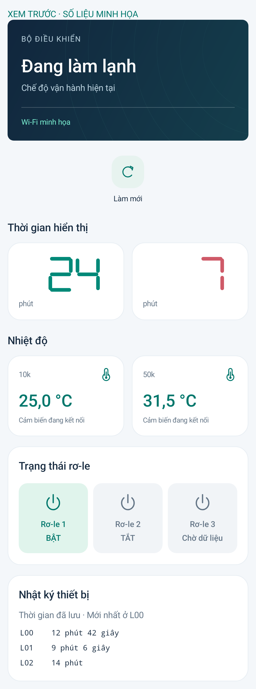

# MS51 Connect 3.1.6

Bỏ hoàn toàn các thanh LED không sáng trong chữ số, chỉ vẽ nét đang bật. Giữ số không có 0 đầu và nhấp nháy theo cơ chế 3.1.5. Cài đè APK; không cần nạp C5/MS51 hoặc cập nhật máy chủ.

Build, lint và kiểm thử Android API 35 đạt; đã xem preview. [Báo cáo](test-results.json).

Ảnh chụp giao diện thật trên emulator, số liệu minh họa:

