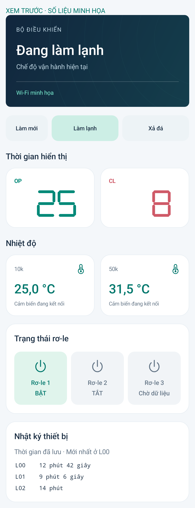

# MS51 Connect 3.2.0 — Chuyển chế độ từ app

Hàng **Làm mới · Làm lạnh · Xả đá** rộng bằng hàng OP/CL; hai nút chế độ dài hơn Làm mới. App chỉ mở nút khi có trạng thái mới từ MS51 hỗ trợ tính năng này. Khi gửi lệnh, khóa cả ba nút để tránh bấm chồng; kết quả được đọc lại từ mạch. Không tự gửi lại lệnh khi mất phản hồi.

## Quy tắc điều khiển

- Chọn trên app: lưu chế độ và nguồn điều khiển vào MS51. Khởi động lại tiếp tục lựa chọn đó dù công tắc vật lý đang ở vị trí khác.
- Gạt công tắc sau đó: ba mẫu ADC ổn định xác nhận chuyển động (~150 ms), chuyển nguồn điều khiển về vật lý và lưu lại. Vị trí công tắc lúc khởi động chỉ làm mốc khi nguồn cuối là app.
- Gửi lại cùng chế độ không khởi động lại bộ đếm, không ghi EEPROM thêm nếu giá trị đã lưu giống nhau.
- Không vượt khóa PIN, khóa hết hạn, tắt máy hoặc màn hình cài đặt tại mạch. Thiết bị bận nạp/cài đặt sẽ từ chối lệnh.
- Số OP/CL vẫn lấy từ mạch; chỉ app nhấp nháy ô đang đếm.

## Cài đặt

Cần **APK 3.2.0 + C5 3.2.0 + MS51-Mode-Control-3.2.0.hex**, cùng server mới. Bo đang nối đã nạp và xác minh cả hai chip; server đã triển khai. APK cùng chữ ký với các bản trước, cài đè giữ đăng nhập.

C5 vẫn DAT=IO1, CLK=IO0, RS=IO3. NTC 10k ở IO6, NTC 50k ở IO4; cả hai B3950, trở kéo lên 3,3 V là 10k. Không đổi đấu dây.

Gói C5 gồm ba tệp: bootloader tại `0x2000`, partition tại `0x8000`, app tại `0x10000`. DIO, 80 MHz, flash 4 MB. Không xóa toàn bộ flash khi cần giữ ghép nối/Wi-Fi. File HEX dùng cho MS51 qua quy trình cập nhật hiện có, không dùng để nạp C5.

## Giao thức

`POST /api/mode` với `{"mode":"COOL"}` hoặc `{"mode":"ICE_FLUSH"}`. Đi qua cloud RPC hiện có với kiểm tra chủ sở hữu, mã yêu cầu chống lặp và khóa thao tác. UART dùng lệnh `0x4D`, payload đúng một byte (0=COOL, 1=ICE_FLUSH), giữ frame/CRC16/sequence hiện có; ACK cùng command, trạng thái 0 khi chấp nhận.

Telemetry bổ sung `mode_source=APP|PHYSICAL`, `selected_mode=0|1|2`. App cũ vẫn đọc được các trường cũ. MS51 cũ thiếu metadata thì app mới không cho bấm chế độ.

Cấu hình công khai vẫn 217 byte. Ba byte nội bộ nối cuối cấu trúc EEPROM: dấu `0xA7`, chủ chế độ (0=vật lý, 1=app lạnh, 2=app xả đá), byte đảo XOR `0xFF`. Giá trị chưa khởi tạo/không hợp lệ dùng công tắc. Giữ nguyên trang EEPROM tại `0x7F00`. Đây là ghi EEPROM theo cơ chế hiện có, không phải nhật ký chống mất điện giữa lúc ghi.

## Kiểm thử

- Android build/lint và bộ kiểm thử trên emulator đạt; kiểm tra trạng thái cũ, mất dữ liệu, thiết bị bận, đang gửi lệnh và kích thước các nút.
- 27 kiểm thử server; 18 kiểm tra hàm C thực trong source: khởi động, chủ điều khiển, gạt/nhiễu, lệnh lặp, PIN/cài đặt/tắt máy. Chạy `python tools/test_mode_owner.py` với GCC/CC trên máy phát triển.
- C5/MS51 đã nạp và xác minh; dữ liệu Wi-Fi/ghép nối và 217 byte cài đặt được đối chiếu giữ nguyên.
- Mạch thật nhận cả hai chế độ qua LAN và HTTPS → MQTT. Reset MS51 giữ lựa chọn app dù công tắc ở phía khác. Người dùng gạt công tắc: nguồn chuyển PHYSICAL; reset tiếp tục PHYSICAL. Lần này chưa thử riêng thao tác ngắt toàn bộ nguồn.

