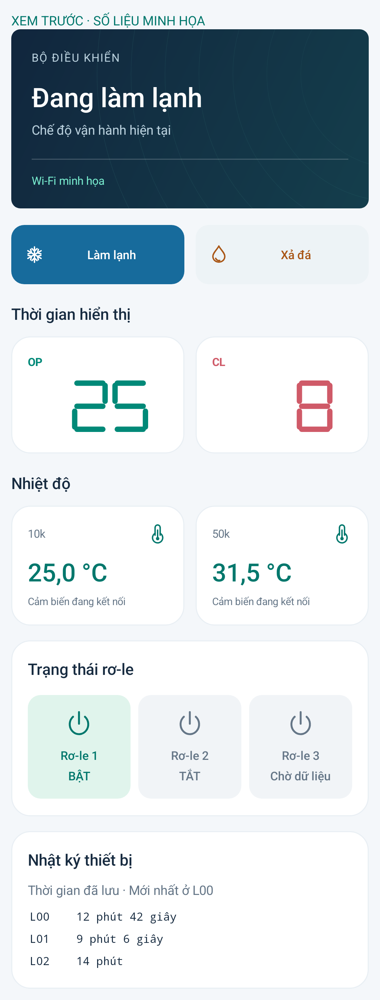
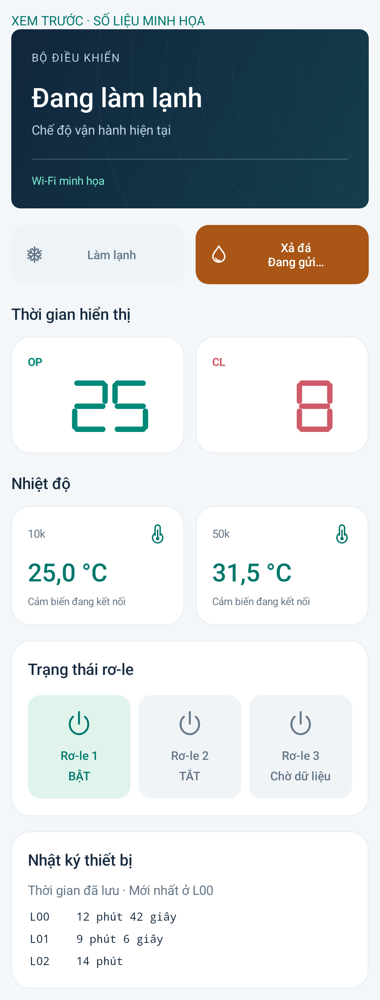

# MS51 Connect 3.2.1

Tổng quan bỏ nút Làm mới, còn hai nút bằng nhau, thẳng mép OP/CL: **Làm lạnh** (bông tuyết, xanh) và **Xả đá** (giọt nước, cam).

Bấm nút đổi màu ngay trên UI thread trước khi xếp lệnh vào hàng đợi mạng. Nút được chọn hiện “Đang gửi…”, sau ACK là “Đang xác nhận…” đến khi telemetry xác nhận lựa chọn. Dữ liệu cũ trong lúc gửi không đảo màu ngược lại. Hai nút tạm khóa để tránh lệnh chồng nhau. Nếu gửi lỗi, trở về dữ liệu xác nhận gần nhất; nếu chờ telemetry quá 5 giây, bỏ lựa chọn tạm, đọc lại trạng thái, không tự gửi lại lệnh. Thẻ trạng thái phía trên luôn theo dữ liệu mạch.

Chỉ cần cài đè APK. Bo/server dùng bản 3.2.0, không nạp lại. App tiếp tục tự đọc trạng thái và nhật ký như trước.

Build, lint, ký APK và Android instrumentation đã kiểm tra thành công. Có kiểm thử lỗi gửi, poll cũ, ACK, xác nhận, hết thời gian, trạng thái bận/cũ và căn hàng khi nhãn hai dòng; giữ các kiểm thử quyền, cảm biến, đếm và nhật ký hiện có. Không gửi lệnh đến bo thật trong lượt thay đổi giao diện này.

## Bình thường

## Ngay sau khi bấm Xả đá

Nút đổi màu ngay, thẻ phía trên vẫn hiển thị chế độ đã đọc được cho tới khi có dữ liệu mới.

