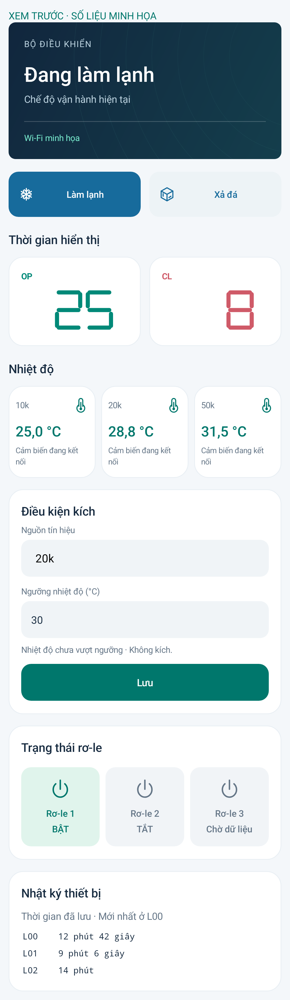

# MS51 Connect 3.3.0 — Ba cảm biến và điều kiện kích

[APK 3.3.0](https://github.com/dangdangduong2k2/esp32c5-ms51-icp/releases/download/v3.3.0/MS51-Connect-3.3.0.apk) · [Bộ nạp C5](https://github.com/dangdangduong2k2/esp32c5-ms51-icp/releases/download/v3.3.0/ESP32-C5-DAT1-CLK0-RS3-THREE-NTC-3.3.0.zip) · [HEX MS51](https://github.com/dangdangduong2k2/esp32c5-ms51-icp/releases/download/v3.3.0/MS51-Trigger-Control-3.3.0.hex)

## Đấu dây và sử dụng

| Cảm biến | Chân C5 | Điện trở kéo lên 3,3 V | Hệ số B |
| --- | --- | --- | --- |
| NTC 10k | IO6 | 10k | 3950 |
| NTC 20k | IO5 | 10k | 3950 |
| NTC 50k | IO4 | 10k | 3950 |

Mỗi nhánh riêng: **3,3 V → trở 10k → chân IO → NTC → GND**. Dùng chung GND. DAT=IO1, CLK=IO0, RS=IO3 giữ nguyên.

Ba ô nhiệt độ nằm trên thẻ **Điều kiện kích**. Chọn nguồn 10k/20k/50k/SIG, nhập ngưỡng rồi **Lưu**. Chọn SIG thì ô ngưỡng bị khóa; MS51 đọc chân **P0.1 (IO01), active-low** như trước. Chọn cảm biến thì chỉ nhiệt độ **lớn hơn** ngưỡng mới kích; bằng hoặc thấp hơn thì không kích. Ngưỡng nhập từ -55 đến 125 °C, tối đa hai chữ số thập phân. Không thêm độ trễ nhiệt (hysteresis).

Nguồn và ngưỡng lưu trên C5; phép so sánh chạy tại bo, không cần app hoặc Internet tiếp tục mở. Tín hiệu thay thế được đưa vào tất cả bốn chỗ đọc SIG trong vòng điều khiển MS51. Không xuất mức điện ra chân SIG vật lý, không đổi logic rơ-le/timer hiện có. Khi chọn cảm biến, mức chân SIG không còn quyết định điều kiện này. Chọn lại SIG để dùng chân như cũ.

Cảm biến lỗi/hết dữ liệu thì điều kiện nhiệt độ không kích. MS51 tự bỏ kích nhiệt độ nếu quá 3 giây không nhận tín hiệu mới từ C5, kể cả lúc mất liên lạc hoặc khởi động lại. Không tự chuyển sang chân SIG khi cảm biến lỗi. Đầu ADC thả nổi có thể tạo giá trị trông hợp lệ; cần đấu đủ điện trở và NTC.

## Cài đặt

Cần APK, C5, MS51 bản 3.3.0 và server hỗ trợ `/api/trigger`. Bo đang nối đã nạp và xác minh cả hai chip; server đã triển khai. APK cùng chữ ký với các bản trước, có thể cài đè. Bản cũ thiếu tính năng sẽ không cho Lưu điều kiện mới.

Gói C5 có ba file tại `0x2000` (bootloader), `0x8000` (partition), `0x10000` (app), DIO/80 MHz/4 MB. Không xóa toàn bộ flash khi cần giữ Wi-Fi và ghép nối. Nạp HEX MS51 qua quy trình cập nhật hiện có, không dùng HEX để nạp C5.

Source mặc định bật ba cảm biến. Gói phát hành dùng layout 4 MB tương thích bo từ 4 MB; `sdkconfig.defaults` của repo giữ lựa chọn flash 16 MB cho bo đang phát triển. Khi tái tạo gói dùng `CONFIG_ESPTOOLPY_FLASHSIZE_4MB=y`, `CONFIG_MS51_ANALOG_IO6=y`, `CONFIG_MS51_NTC_50K_IO4=y`, `CONFIG_MS51_NTC_20K_IO5=y`, cùng DAT1/CLK0/RS3. Không nhúng thông tin ghép nối hoặc Wi-Fi vào gói.

## Giao thức và lưu cấu hình

`POST /api/trigger` nhận đúng hai trường:

```json
{"source":"20K","threshold_centi":3000}
```

Nguồn hợp lệ: `SIG`, `10K`, `20K`, `50K`; nhiệt độ là số nguyên phần trăm °C. Trả `ok` khi đã lưu trên C5; `GET /api/status` có `trigger.synced` để chờ MS51 xác nhận. Trường `analog20k` độc lập với `analog` (10k) và `analog50k`. Không ghi đè nội dung form đang chỉnh khi polling. Lệnh Lưu và chuyển chế độ chặn bấm chồng nhau; mất phản hồi không tự gửi lại.

Cloud RPC kiểm tra phiên, chủ sở hữu và khóa cập nhật như lệnh chế độ hiện có. Tín hiệu C5→MS51 dùng command `0x54`, CRC/sequence theo giao thức cũ, payload 2 byte: nguồn 0=SIG/1=10k/2=20k/3=50k và trạng thái 0/1. Heartbeat khoảng 500 ms, timeout ACK 500 ms. Lệnh người dùng có thể đợi tối đa 750 ms để tránh tranh chấp với heartbeat; thao tác lập trình dài vẫn được khóa. Telemetry thêm `sig_source`, `sig_active`, `sig_link`, tổng 12 biến. Bộ đệm TX MS51 384 byte với chỉ mục 16-bit.

C5 lưu blob NVS `ms51_trigger/config` gồm magic, nguồn, ngưỡng. MS51 lưu 3 byte dấu/nguồn/đảo nối sau dữ liệu riêng của lựa chọn chế độ. Cấu hình công khai vẫn 217 byte, toàn bộ struct 223 byte tại trang EEPROM cũ `0x7F00`. Chỉ ghi lại khi nguồn thay đổi, không ghi EEPROM mỗi heartbeat. Cơ chế EEPROM kế thừa không phải nhật ký chống mất điện giữa lần ghi.

## Kiểm thử

- Android assemble/lint và instrumentation đạt: ba ô độc lập, lỗi cảm biến, giữ nội dung đang nhập, chống chồng lệnh, hồi quy OP/CL, quyền cài đặt, cập nhật, lịch sử.
- 28 kiểm thử server đạt. `python tools/test_trigger.py` với GCC chạy các hàm C thực: SIG active-low, nguồn ảo, timeout, khởi động lại, tràn bộ đếm, ghi lặp, gói không hợp lệ, công thức và lỗi của cả ba NTC.
- Keil: 0 lỗi/0 cảnh báo; HEX dưới vùng EEPROM. C5 build đạt và vừa phân vùng. Nạp/verify hai chip; NVS C5 không đổi qua lần nạp và 217 byte cài đặt MS51 giữ nguyên.
- Mạch thật: đúng chân IO6/IO5/IO4; nhiệt độ dưới/trên ngưỡng làm SIG OFF/ON; đổi đủ bốn nguồn; reset MS51 rồi nối lại; thử qua cả LAN và HTTPS → MQTT → C5 → MS51. Đã trả về SIG sau kiểm thử.
- Chưa thử ngắt toàn bộ nguồn riêng lần này; chưa đối chiếu nhiệt độ với nhiệt kế chuẩn hoặc xác minh độc lập cảm biến đang gắn trên từng chân. Ảnh dưới dùng số liệu minh họa, không phải phép đo trên mạch.

[Kết quả và mã SHA256](test-results.json)

## Sửa lỗi lưu cài đặt — 14/10/2026

Máy chủ trước đây ghép các mục được sửa vào toàn bộ gói GET rồi gửi SET, giữ cả bộ đếm và cờ mật khẩu đang chạy. MS51 yêu cầu các byte trạng thái PIN bằng 0 khi SET, nên có thể báo “cấu hình có giá trị ngoài giới hạn” dù các thông số nhập hợp lệ.

`server/managed.py` chuẩn hóa phần PIN trước khi gửi: khi bật, giữ mật khẩu, chu kỳ, đơn vị và tùy chọn, chỉ xóa trạng thái chạy tại `0xC9..0xCB`, `0xCE..0xCF`, `0xD7..0xD8`; khi tắt, gửi khối `0xC5..0xD8` gồm 20 byte 0 theo giao thức hiện có. Giữ kiểm tra quyền sửa và giới hạn từng mục. Các thiết lập khác và lịch sử không bị chuẩn hóa lại.

Đã chạy 30 kiểm thử server; hàm kiểm tra C thực của MS51 từ chối cấu hình lỗi trước sửa và chấp nhận sau sửa. Đã triển khai VPS, lưu lại cấu hình hiện tại qua HTTPS/MQTT trên thiết bị gặp lỗi, nhận ACK thành công và đọc lại đủ 51 mục không thay đổi; PIN vẫn bật. Đây là bản sửa phía máy chủ, không cần APK hoặc nạp chip mới. Mỗi lần lưu vẫn khởi động lại bộ điều khiển và khởi tạo lại trạng thái đếm PIN theo hành vi SET hiện có.


