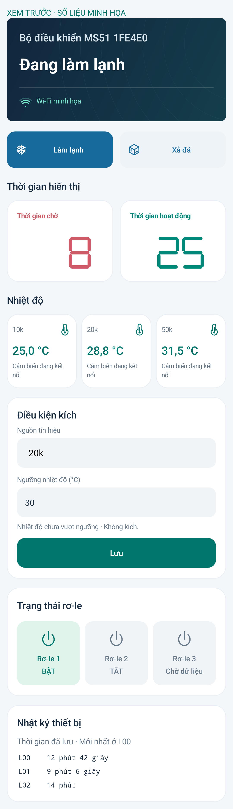

# MS51 Connect 3.3.4

Tên thiết bị được đưa vào sau **Bộ điều khiển** trong thẻ Tổng quan, chữ lớn và đậm vừa; dòng trạng thái đậm hơn. Bỏ dòng **Chế độ vận hành hiện tại**.

Thêm biểu tượng Wi-Fi trước tên mạng, với 1–4 mức theo dBm do C5 gửi về. Thiếu số đo hoặc mất kết nối hiển thị biểu tượng gạch chéo.

Cài đè APK, không cần nạp lại C5/MS51. Đã build, lint, kiểm tra chữ ký và kiểm thử trên máy giả lập. Chưa kiểm thử trên điện thoại thật.

