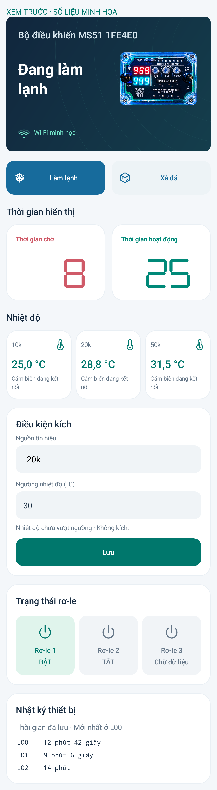

# MS51 Connect 3.3.6

Thêm ảnh thiết bị kèm **toàn bộ hộp trong suốt** ở bên phải trạng thái trên thẻ Tổng quan, theo mẫu đã duyệt. Cả hai cụm số trên ảnh là **999**: trên đỏ, dưới xanh.

Ảnh minh họa cố định được đóng gói trong APK. Hai ô thời gian bên dưới vẫn hiển thị dữ liệu thật từ mạch.

Cài đè APK, không cần nạp lại C5/MS51. Đã build, lint, kiểm tra chữ ký và kiểm thử trên máy giả lập. Chưa kiểm thử trên điện thoại thật.

Ảnh được tạo bằng công cụ image_gen tích hợp, từ ảnh thiết bị của người dùng; [prompt](image-prompt.txt). [Tệp ảnh trong app](../../mobile/android/app/src/main/res/drawable-nodpi/controller_enclosure.png).
