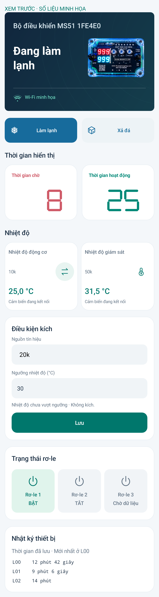

# MS51 Connect 3.3.7

Gộp 10k và 20k thành ô **Nhiệt độ động cơ**, chỉ hiện một cảm biến tại một thời điểm. Nút hai mũi tên phía trên đổi **10k ↔ 20k**; nhãn cho biết cảm biến đang xem. Lựa chọn được lưu trên điện thoại theo tài khoản và thiết bị.

Ô **Nhiệt độ giám sát** hiển thị riêng cảm biến **50k**. Đổi cảm biến đang xem không ghi cấu hình xuống mạch và không đổi Điều kiện kích. Cảm biến lỗi hoặc dữ liệu cũ vẫn hiển thị chờ/kiểm tra, không tự lấy nhiệt độ cảm biến khác thay vào.

Cài đè APK, không cần nạp lại C5/MS51. Đã build, lint, kiểm tra chữ ký và kiểm thử trên máy giả lập. Chưa kiểm thử trên điện thoại thật.

