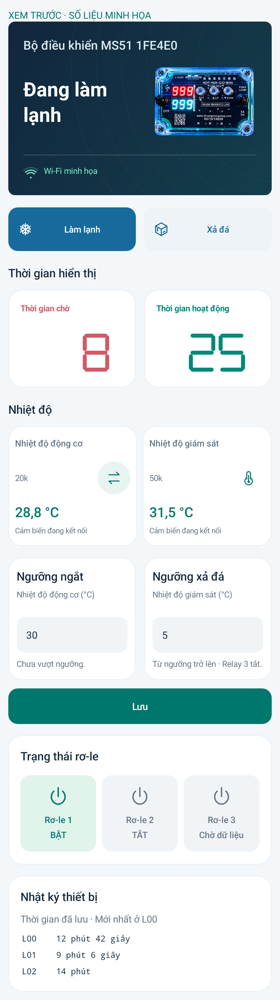

# MS51 Connect 3.4.0

Hai ô **Ngưỡng ngắt** và **Ngưỡng xả đá** nằm cạnh nhau dưới nhiệt độ.

- Ngưỡng ngắt dùng cảm biến **10k/20k** đang chọn trong ô Nhiệt độ động cơ. Nút đổi cảm biến giờ là lựa chọn cho điều khiển; bấm **Lưu** để áp dụng cùng hai ngưỡng. Nhiệt độ **lớn hơn** ngưỡng kích logic SIG như trước; bằng/thấp hơn không kích.
- Ngưỡng xả đá dùng **50k**, chỉ điều khiển **relay 3**: nhiệt độ **thấp hơn** ngưỡng thì bật; bằng/cao hơn thì tắt, độc lập chế độ mạch.
- 50k lỗi/mất mẫu: relay 3 trở về điều khiển gốc của mạch. Mất liên lạc C5–MS51 quá 3 giây cũng trở về mạch. Không thay đổi relay 1/2 trong bộ điều khiển ngưỡng xả đá.
- Cấu hình lưu trên C5, tiếp tục hoạt động khi điện thoại/Internet ngắt. Sau nâng cấp, chưa tự kích hoạt ngưỡng xả đá: nhập ngưỡng rồi Lưu.

**Cần cập nhật cả APK, C5 và MS51.** Bo đang kết nối đã được nạp và xác minh; Wi-Fi/ghép nối giữ nguyên. Sau kiểm thử đã khôi phục ngưỡng ngắt cũ 32°C, nguồn 10k và xả đá theo mạch, chờ người dùng nhập ngưỡng mới.

Đã kiểm thử app trên máy giả lập, 33 kiểm thử máy chủ, logic relay khi mất cảm biến/mất liên lạc, và lệnh HTTPS → MQTT → C5 → MS51 trên bo thật. Đã xác nhận relay 3 ON/OFF qua dữ liệu phản hồi từ MS51. Chưa đo điện áp tại tiếp điểm relay hoặc thử rút cảm biến thật; trường hợp lỗi/mất dữ liệu được kiểm thử bằng chương trình chạy logic C của MS51. Chưa kiểm thử mất điện toàn bộ sau lưu hai ngưỡng.

