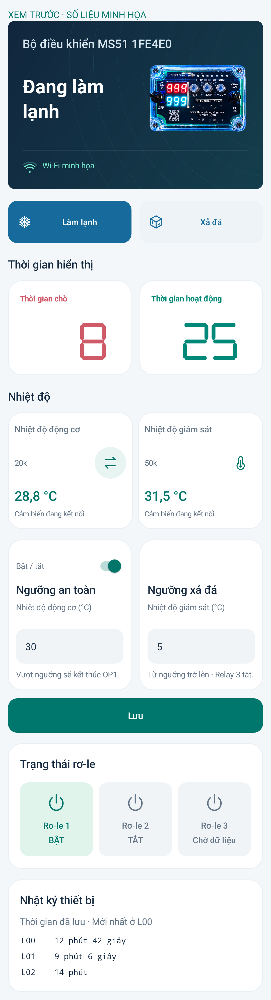

# MS51 Connect 3.4.2 · Ngưỡng an toàn OP1

Đổi **Ngưỡng ngắt → Ngưỡng an toàn**, thêm công tắc bật/tắt nhỏ phía trên. Chọn cảm biến 10k/20k ở ô **Nhiệt độ động cơ**, nhập ngưỡng và nhấn **Lưu** để áp dụng cả công tắc, nguồn cảm biến và hai ngưỡng.

- Khi bật và nhiệt độ động cơ **lớn hơn** ngưỡng: kết thúc OP1 ngay ở vòng xử lý kế tiếp khi MS51 nhận trạng thái vượt ngưỡng, chuyển sang **CL1** qua đúng đường chuyển bước khi hết thời gian. Không chờ số đếm giảm; áp dụng cả OP1 đang bị HCF giữ bộ đếm.
- Bằng/thấp hơn ngưỡng, tắt công tắc hoặc cảm biến lỗi: không ép chuyển bước. Ngưỡng không nhảy CL1 hay OP2 xả đá độc lập. Nếu còn nóng khi chu trình vào OP1 lần sau, OP1 đó cũng kết thúc.
- **SIG vẫn đọc chân vật lý P0.1**. Ngưỡng an toàn không giả lập SIG. Ngưỡng xả đá 50k/relay 3 giữ nguyên.
- Lưu trên C5, chạy không cần điện thoại/Internet. Cấu hình cũ khi nâng cấp mặc định tắt ngưỡng an toàn. C5 gửi trạng thái khoảng mỗi 500 ms; mất liên lạc C5–MS51 từ 3 giây thì hết hiệu lực ép kết thúc OP1. Đây không phải mạch bảo vệ nhiệt độc lập với C5/MS51.

**Cần cập nhật APK, C5 và MS51 cùng bản này.** App khóa công tắc nếu bộ điều khiển chưa hỗ trợ. API và lệnh cũ không bật được chức năng an toàn mới. Máy chủ đã cập nhật tương thích với cả app cũ và mới.

**Chỉ xuất file để nạp sau theo yêu cầu; chưa nạp hoặc kiểm thử trên bo thật.** Đã build APK/C5/MS51, kiểm tra giao diện bằng app thật trên máy giả lập, 33 kiểm thử máy chủ, kiểm thử logic C của MS51 (kể cả đường hết OP1 → CL1), cấu hình C5 và các tình huống lỗi/mất dữ liệu. MS51: 28.021 byte mã, 0 lỗi, 0 cảnh báo; vùng cấu hình được giữ ngoài ảnh HEX.

