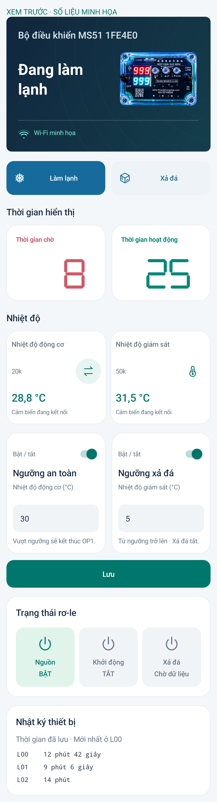

# MS51 Connect 3.4.5 · Công tắc xả đá và tên đầu ra

Thêm công tắc **Bật / tắt** phía trên **Ngưỡng xả đá**, độc lập với Ngưỡng an toàn. Nhấn **Lưu** để áp dụng; lưu trên C5 và giữ qua khởi động lại.

- **Bật:** nhiệt độ giám sát 50k thấp hơn ngưỡng thì bật Xả đá (relay 3); bằng hoặc cao hơn ngưỡng thì tắt.
- **Tắt:** trả Xả đá về chu trình gốc của MS51. Không có nghĩa là ép relay 3 tắt. Cảm biến lỗi hoặc mất liên lạc vẫn trở về điều khiển theo mạch.
- Ngưỡng an toàn dùng nhiệt độ động cơ và hoạt động độc lập. Nâng cấp cấu hình cũ giữ nguyên nguồn cảm biến, các ngưỡng và trạng thái xả đá đang bật.
- Đổi tên ba ô trạng thái: relay 1 → **Nguồn**, relay 2 → **Khởi động**, relay 3 → **Xả đá**. Chỉ đổi tên hiển thị, giữ nguyên số thứ tự và tín hiệu điều khiển.
- Giữ bản sửa không tự cuộn xuống nút Lưu và nhấp nháy bộ đếm. Bản C5 cũ chưa hỗ trợ sẽ khóa công tắc mới và báo cần cập nhật; app cũ vẫn được API chấp nhận.

**Cập nhật APK và C5 3.4.5. MS51 tiếp tục dùng 3.4.4, không cần nạp lại.** Máy chủ đã cập nhật. C5 đã được nạp và xác minh, giữ nguyên vùng lưu Wi-Fi/ghép nối/cấu hình.

Đã build C5, APK và lint; 33 kiểm thử máy chủ; kiểm thử C thực tế cho cấu hình v1/v2/v3 → v4, bốn tổ hợp hai công tắc, lưu/khởi động lại, lỗi cảm biến và trả quyền điều khiển relay; kiểm thử giao diện và cuộn trang trên máy giả lập. Hình xem trước dùng số liệu minh họa. Chưa kiểm thử thao tác trên điện thoại người dùng.

Sau khởi động, đã đọc lại C5 online, xác nhận cấu hình và hai công tắc được giữ đúng, kết nối MS51 đã đồng bộ. Không thay ngưỡng hoặc kích thử relay trên bo.

