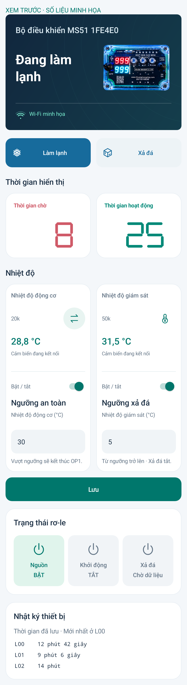

# MS51 Connect 3.4.6 · Ghép nhiệt độ và ngưỡng

Ghép nhiệt độ và ngưỡng liên quan thành hai thẻ liền nhau theo cột:

- Bên trái: **Nhiệt độ động cơ + Ngưỡng an toàn**.
- Bên phải: **Nhiệt độ giám sát + Ngưỡng xả đá**.

Mỗi cột dùng chung nền trắng và viền bo tròn, có đường phân cách mảnh giữa số đo và phần cài đặt. Giữ hai công tắc, chọn 10k/20k, ô nhập ngưỡng và nút Lưu chung. Không đổi thuật toán hoặc cấu hình thiết bị.

**Chỉ cập nhật APK; không cần nạp lại C5 hay MS51.** Giữ C5 3.4.5 và MS51 3.4.4 đang dùng.

Đã build, lint, kiểm tra giao diện thực trên máy giả lập và kiểm thử cuộn trang/giữ nội dung đang nhập. Preview dùng số liệu minh họa; chưa kiểm tra trực tiếp trên điện thoại người dùng.

