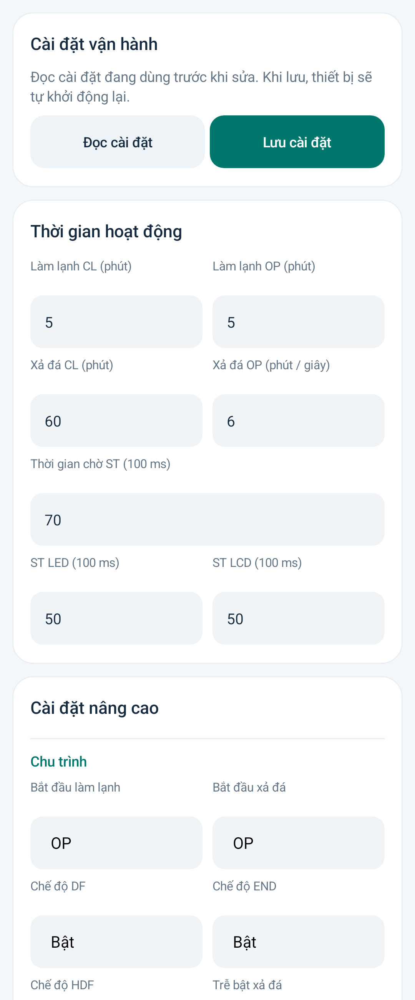
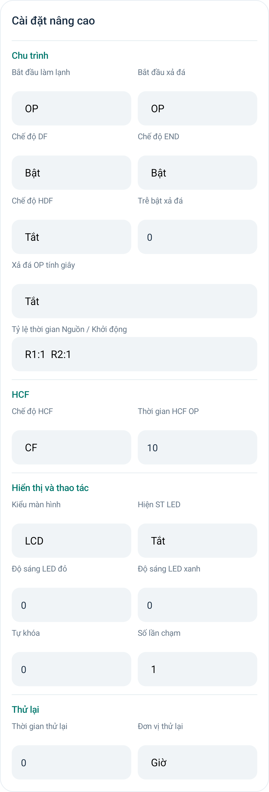

# MS51 Connect 3.4.7 · Cài đặt gọn theo nhóm

Sắp xếp lại Cài đặt, bố trí các tham số liên quan trên cùng hàng để giảm chiều dài màn hình.

**Thời gian hoạt động** chỉ gồm 7 tham số: Làm lạnh CL, Làm lạnh OP, Xả đá CL, Xả đá OP, Thời gian chờ ST, ST LED, ST LCD. CL/OP cùng chế độ nằm cạnh nhau; ST LED/ST LCD cùng hàng.

Các tham số thời gian còn lại và phần Chế độ và hiển thị được gom vào **Cài đặt nâng cao**, chia nhóm nhỏ Chu trình, HCF, Hiển thị và thao tác, Thử lại. Thời gian và đơn vị đặt cạnh nhau. Giới hạn Min/Max và Mật khẩu bảo vệ vẫn là mục riêng, sử dụng bố cục gọn tương ứng.

Các trường bị admin ẩn không để lại ô trống, nhóm không còn trường được phép sẽ ẩn. Màn hình dưới 340 dp hoặc cỡ chữ từ 130% dùng một cột để tránh ép chữ. Giữ nguyên khóa trường mật khẩu, dữ liệu đọc/lưu và quyền quản lý.

**Chỉ cập nhật APK, không cần nạp lại C5 hoặc MS51.** Đã build/lint và kiểm thử trên máy giả lập: 7 trường đúng nhóm, cặp tham số chung hàng, quyền ẩn/hiện, giữ giá trị cấu hình, khóa mật khẩu và hồi quy giao diện. Hình xem trước dùng cấu hình minh họa; chưa kiểm tra trực tiếp trên điện thoại người dùng.

