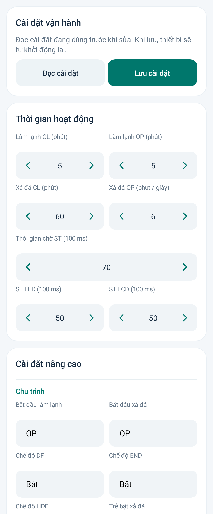

# MS51 Connect 3.4.8 · Mũi tên tăng giảm có gia tốc

Thêm mũi tên giảm / tăng hai bên các ô số trong **Cài đặt**, giữ bố cục hai cột và các nhóm tham số liên quan.

- Nhấp: thay đổi đúng **1 đơn vị**.
- Giữ: sau 450 ms bắt đầu lặp chậm, mỗi lần 1 đơn vị; từ 2 giây chuyển sang 5 đơn vị/lần và nhanh hơn; từ 5 giây chuyển sang 10 đơn vị/lần với tốc độ cao nhất.
- Thả tay, kéo ra khỏi nút, cuộn trang, khóa trường hoặc rời màn hình sẽ dừng lặp. Thả nút không cộng thêm một lần.
- Chạm số ở giữa để nhập trực tiếp. Mũi tên giữ giá trị trong giới hạn của tham số; thời gian CL/OP và ST cũng theo Min/Max hiện có. Nếu cặp Min/Max đang nhập không hợp lệ, mũi tên chờ sửa giới hạn.
- Quyền ẩn/hiện và khóa mật khẩu được giữ nguyên. Nhấn **Lưu cài đặt** để gửi thay đổi xuống thiết bị.

**Chỉ cập nhật APK, không cần nạp lại C5/MS51.** Đã build/lint và kiểm thử app trên máy giả lập: nhấp một đơn vị, giữ tăng tốc, thả/hủy/khóa/rời trang dừng lặp, giới hạn số, nhập tay, hiển thị chữ số, phân quyền và hồi quy giao diện. Preview dùng số liệu minh họa; chưa thử trực tiếp trên điện thoại người dùng.

