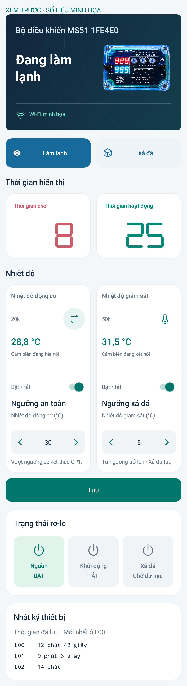

# MS51 Connect 3.4.9 · Tăng giảm hai ngưỡng

Thêm mũi tên giảm/tăng có gia tốc cho **Ngưỡng an toàn** và **Ngưỡng xả đá** trên Tổng quan.

- Nhấp đổi **1°C**; giữ lâu tăng tốc dần giống các ô số trong Cài đặt. Thả tay hoặc rời trang thì dừng.
- Chạm số ở giữa để nhập trực tiếp. Hỗ trợ số âm và số thập phân; ví dụ 30,5 → 31,5 khi nhấp tăng. Giữ trong khoảng −55 đến 125°C.
- Tắt ngưỡng, đang lưu hoặc điều khiển chưa sẵn sàng: khóa cả ô nhập và hai mũi tên.
- Nhấn **Lưu** để áp dụng. Không thay đổi nguyên lý điều khiển ngưỡng hoặc relay.

**Chỉ cập nhật APK; không cần nạp lại C5/MS51.** Đã build/lint và kiểm thử trên máy giả lập: nhấp/giữ/dừng, hai ngưỡng tăng giảm đúng 1°C, công tắc khóa mũi tên, số âm/thập phân/dấu phẩy, giới hạn, giữ dữ liệu đang sửa và vị trí cuộn. Preview dùng số liệu minh họa; chưa kiểm tra trực tiếp trên điện thoại người dùng.

